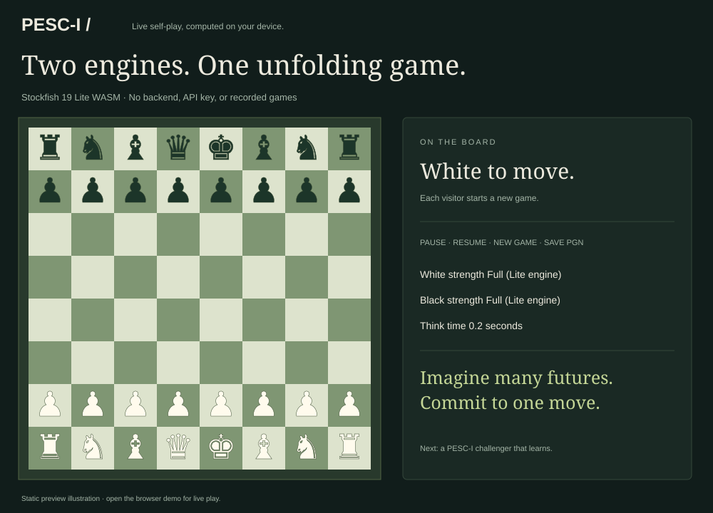

# PESC-I browser chess

Two Stockfish engines, one board, no hosting bill for a game server.

This is the **web branch**: a static, browser-only Stockfish self-play page.
Each visitor runs their own match on their own device. The
[main branch](https://github.com/sksubiit/pesc-i/tree/main) contains the separate
Python desktop GUI with optional LLM commentary.

[](https://sksubiit.github.io/pesc-i/)

[Open the demo](https://sksubiit.github.io/pesc-i/) once it has been published.
The README image is a static illustration; GitHub Markdown cannot run a live board.

## Run locally

Install Node.js 20 or newer, then:

```bash
git clone --depth 1 --branch web https://github.com/sksubiit/pesc-i.git pesc-i-web
cd pesc-i-web
npm ci --include=dev --ignore-scripts --no-audit --no-fund
npm run build:web
npm start
```

For a fork, replace the clone URL with your repository URL.
Open the address printed by the launcher, normally http://127.0.0.1:8000/.
Busy ports are skipped automatically; choose another starting port with
`npm start -- --port 8080`. Use HTTP rather than opening index.html directly:
Workers and WebAssembly need a web origin.

No Python, venv, native Stockfish installation, API key, or model server is needed.
The first build downloads pinned dependencies and verified engine source/network
material. During play, computation stays in the browser.

## At the board

Pause stops the engine workers; Resume continues the existing game.
New game applies the selected strength, search time, and move pace.
Flip board changes the view, and Save PGN downloads the current game.
Auto-next starts another game after a result. Hidden tabs pause automatically;
press Resume when you return. Closing the page stops its computation.

The engine is **Stockfish 19 Lite WASM**, from `stockfish@19.0.1`, single-threaded.
Lite trades playing strength for a small download. Strength caps are approximate.
The displayed score is from White's perspective for the last search, before the move.
Visitors are not synchronized; refreshing starts a new game.

## Publish

The deployment workflow lives **only on main**, at
`.github/workflows/pages.yml`. It explicitly checks out **web**, builds and tests
it, then uploads only the static `web/` directory.

Push both branches to the same repository. Keep main as the default branch,
choose **GitHub Actions** in Settings → Pages, then run
**Deploy web branch to GitHub Pages** from main in the Actions tab.
A push to web alone does not deploy: run the workflow after each desired update.

See the [deployment guide on main](https://github.com/sksubiit/pesc-i/blob/main/docs/deployment.md).
For forks, use the guide on your own main branch and your own Actions/Pages settings.
The usual project URL is `https://OWNER.github.io/REPOSITORY/`.
The website needs no always-running service; visitors supply the engine compute.

To disable startup for new sessions, set `ENABLED = false` in
`web/config.mjs`, push web, then deploy again. Existing sessions must stop or refresh.
Unpublish Pages in repository settings to stop serving the page entirely.

## Develop

```bash
npm test
```

Tests cover game control, UCI transport, rendering data, and real WASM self-play.
They do not replace a visual check in a browser.
See [browser behavior and source map](docs/browser-web.md).

Keep work on this branch. Do not merge the complete desktop tree into it.
The long-term goal is Stockfish versus a recursively improving PESC-I engine;
that learning engine is future work. The UCI adapter provides a starting seam.

Original PESC-I code is [BSD-3-Clause](LICENSE); third-party licenses still apply.
See [third-party notices](THIRD_PARTY_NOTICES.md).
