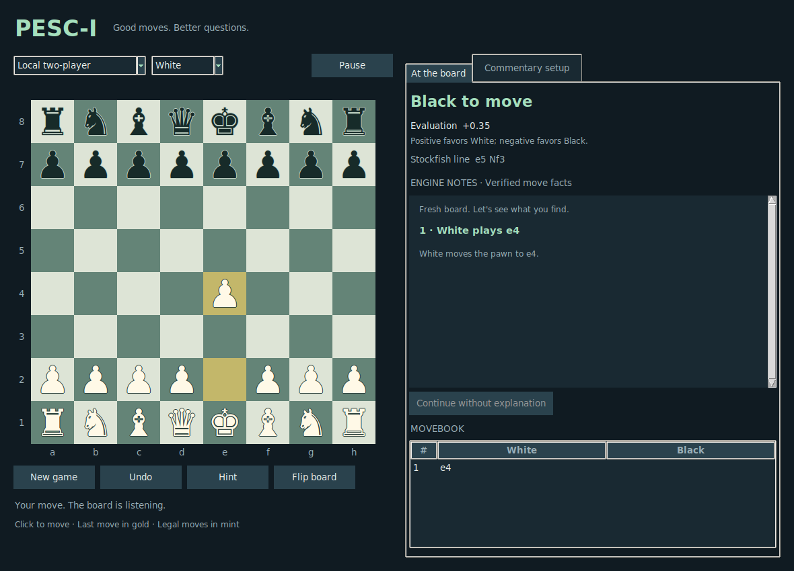

# PESC-I

### Good moves. Better questions.

A desktop chess board with **Stockfish analysis** and optional **LLM explanations**.
Play against Stockfish, share a board with a friend, or watch two very stubborn
calculators negotiate. After each move, see the evaluation, a suggested continuation,
and a short explanation.

Stockfish does the chess. Your chosen language model puts words around it.
No model server or API key is required to play.



## Start playing

Python 3.10+ and a graphical desktop are required. On Ubuntu / WSL:

```bash
sudo apt update
sudo apt install python3-venv python3-tk stockfish fonts-dejavu-core
cd pesc-i
bash scripts/setup.sh
source .venv/bin/activate
pesc-i
```

Clone this repository first if you haven't already. Run these commands in your
Linux / WSL terminal. WSL needs WSLg (GUI support); SSH and headless terminals need
a graphical display. You can also launch with `python run_gui.py`.

The setup script installs the app into a project-local `.venv`. To rebuild it:

```bash
bash scripts/setup.sh --recreate
source .venv/bin/activate
pesc-i
```

`--recreate` clears this checkout's `.venv`, including packages you installed there.
It leaves the repository and your saved app preferences alone.

Stockfish is resolved in this order:

1. The executable named by `STOCKFISH_PATH`.
2. A system installation (`stockfish` on PATH or `/usr/games/stockfish`).
3. The legacy bundled Linux x86-64 binary in `stockfish/stockfish`.

Prefer the system package. On another platform, install Tk and a compatible
Stockfish executable, create a venv with `python -m venv .venv`, install with
`python -m pip install -e .`, and set `STOCKFISH_PATH` if needed. For example:

```bash
export STOCKFISH_PATH=/absolute/path/to/stockfish
pesc-i
```

## At the board

- **Play Stockfish** — choose White or Black. Playing Black lets Stockfish open.
- **Local two-player** — both players use the same board.
- **Watch Stockfish** — engine versus engine; use Pause / Resume to control the pace.

Click a piece, then a highlighted destination. Promotions offer queen, rook,
bishop, or knight. Gold squares show the previous move; **Hint** highlights an
engine suggestion. **Flip board** changes the view.

**New game**, changing the mode, or changing your playing side starts a fresh board.
**Undo** returns to your turn against Stockfish; it takes back one move in the
other modes. Undo pauses a watched game.

The right panel shows:

- Whose turn it is, check, and the final result.
- Stockfish's evaluation in pawns: **positive favors White**, negative favors Black.
  Mate scores name the winning side.
- A legal continuation from the position **after** the move.
- Engine notes, followed by the selected model's explanation.

Analysis and network requests run in the background. A slow model doesn't stop
you using the controls: **Continue without explanation** skips that move's prose.
Skipped or reset results are discarded; an already-sent request may still finish
on the server. Automatic play waits for each explanation so it doesn't flood a
local model with requests.

## Choose a commentator

Open **Commentary setup**, choose a provider, select a discovered model (or type its
exact ID), and click **Apply commentary settings**. Settings apply to the next move.
The active provider is displayed separately from the settings being edited.

| Provider                   | Base URL                                            | Model discovery                       |
| -------------------------- | --------------------------------------------------- | ------------------------------------- |
| Engine notes (offline)     | None                                                | None needed                           |
| LM Studio                  | `http://localhost:1234/v1`                        | `GET /v1/models`                    |
| Ollama                     | `http://localhost:11434`                          | `GET /api/tags`                     |
| Remote / OpenAI-compatible | Your provider's API base, usually ending in `/v1` | `GET /models` relative to that base |

Local providers are checked when selected. **Find available models** refreshes the
list after loading or downloading another model. Discovery lists what the server
reports; it doesn't benchmark quality or guarantee that every listed model supports
chat. Embedding models are filtered out by name.

### LM Studio

1. Install [LM Studio](https://lmstudio.ai/), download a chat/instruct model, and load it.
2. Start the local server in LM Studio's Developer area.
3. Select **LM Studio** in PESC-I. Check the URL, find models, choose one, and Apply.
4. If you enabled server authentication, enter its token in the API key field.

PESC-I uses LM Studio's documented [model listing](https://lmstudio.ai/docs/developer/openai-compat/models)
and [OpenAI-compatible chat endpoint](https://lmstudio.ai/docs/developer/openai-compat).
The listed models may include downloaded models available for just-in-time loading.

### Ollama

Install [Ollama](https://ollama.com/), then download a chat model you want to use:

```bash
ollama pull <model-name>
ollama list
ollama serve
```

Replace `<model-name>` with an actual model ID. If Ollama is already running,
you don't need another `ollama serve` process.

Select **Ollama**, find models, choose a downloaded model, and Apply.
The app uses Ollama's native [model list](https://docs.ollama.com/api/tags)
and [chat API](https://docs.ollama.com/api/chat); leave `/v1` off the Ollama base URL.

### Remote APIs

Choose **Remote / OpenAI-compatible**, enter the provider's base URL and API key,
and find models. If the service doesn't expose a model list, type the model ID
from its documentation and Apply.

The service must support **Chat Completions** with `model`, `messages`,
`max_tokens`, and `temperature`. APIs that require another protocol or different
parameters need an adapter; selecting a provider doesn't make all APIs compatible.

You can supply the remote key through the masked field or `PESC_I_API_KEY` in the
launching shell. Keys are kept in memory and are never written to preferences.
Move facts and Stockfish scores are sent to the selected endpoint. Remote calls
may incur the provider's normal charges. There is no automatic switch to a paid API.

### Local server on Windows, board in WSL

Try `localhost` first. If the Windows server is unreachable from WSL, use the
Windows host address as seen from your WSL network. In the usual NAT configuration,
`ip route show default` shows the gateway address; mirrored networking behaves
differently. Do not assume the DNS nameserver is the Windows host.

Change the URL in the app, for example `http://<windows-host>:1234/v1` or
`http://<windows-host>:11434`. Configure the server to listen on a reachable
interface and allow the connection through Windows Firewall on your private network.
For Ollama, see its [network configuration guide](https://docs.ollama.com/faq).
Only expose your model server to networks you trust.

## About explanation quality

A language model can sound confident while being wrong. Smaller models are
particularly fond of finding imaginary forks. PESC-I supplies concrete move facts,
White-perspective scores, and a legal Stockfish continuation, with instructions
to avoid unsupported tactical claims. This improves grounding; it does **not**
turn a language model into a chess engine.

Use a chat/instruct model that runs comfortably on your hardware. Try Brief first.
The offline notes are always available and make fewer promises.
Cold model loading can take longer than the request timeout. Reasoning models may
also spend their token budget thinking and return no usable explanation; try a
chat/instruct model instead. Ollama requests disable optional thinking for these
short explanations. Failed requests,
authentication errors, timeouts, and empty replies visibly fall back to engine
notes. The board's evaluation always comes from Stockfish.

Evaluations and move-loss estimates depend on the search budget; they are not
certified move grades. Increase the engine time for a steadier analysis.
“Voice” currently means written commentary, not synthesized audio.

## Troubleshooting and development

```bash
source .venv/bin/activate
python -m scripts.doctor
bash scripts/check.sh
# Optional linting
python -m pip install -e '.[dev]'
ruff check src tests scripts run_gui.py
```

Tests exercise real Stockfish analysis, local mock HTTP servers, and the Tk workflow.
GUI tests skip on a headless machine; run under WSLg or `xvfb-run` to include them.
Tests never call a paid model API.

- **No window:** check WSLg / DISPLAY and that `python3-tk` is installed.
- **Engine error:** check `STOCKFISH_PATH`, executable permissions, and architecture.
- **No models:** start the server, load/pull a chat model, then refresh.
- **Remote authentication or model error:** check the key, API base URL, and exact model ID.
- **Long explanations:** shorten the response, adjust the timeout, or skip the prose.

Preferences live at `~/.config/pesc-i/settings.json` (or under `XDG_CONFIG_HOME`).
They restore as a draft; click Apply to enable the provider each session.
Delete that file to reset preferences.

Code is split into `src/engine` (Stockfish), `src/voice` (facts and provider clients),
and `src/gui` (desktop layout and game flow). `run_gui.py` is a convenience launcher.
The old `src/gui_tk.py` import remains a compatibility shim.

The legacy bundled Stockfish identifies itself as 17.1. Stockfish is GPLv3 software;
see [its license](stockfish/COPYING.txt) and [upstream source](https://github.com/official-stockfish/Stockfish/tree/sf_17.1).
Use the upstream distribution with corresponding source and license notices when
redistributing engine binaries.

## License

Original PESC-I code and assets use [BSD-3-Clause](LICENSE), allowing
commercial use subject to its license-notice conditions. A repository credit is
appreciated; it does not replace preserving the required notices.
[Third-party notices](THIRD_PARTY_NOTICES.md) describe Stockfish and python-chess,
which retain their GPL licenses.

The desktop API key field is session-only. Apply does not save the key to disk.
For the remote provider, `PESC_I_API_KEY` may be supplied by the launching process.
The app does not automatically load `.env` files. Keep persistent secrets outside
the repository, for example in an OS credential store or private launcher.
